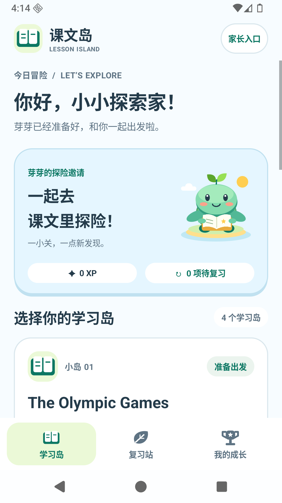
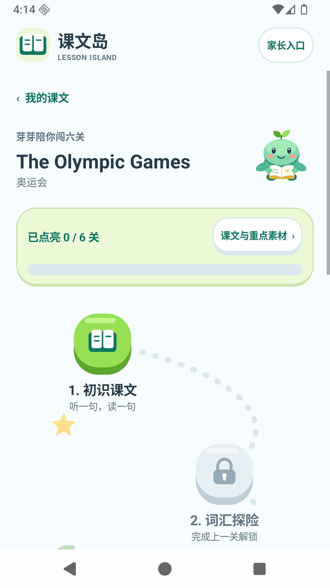
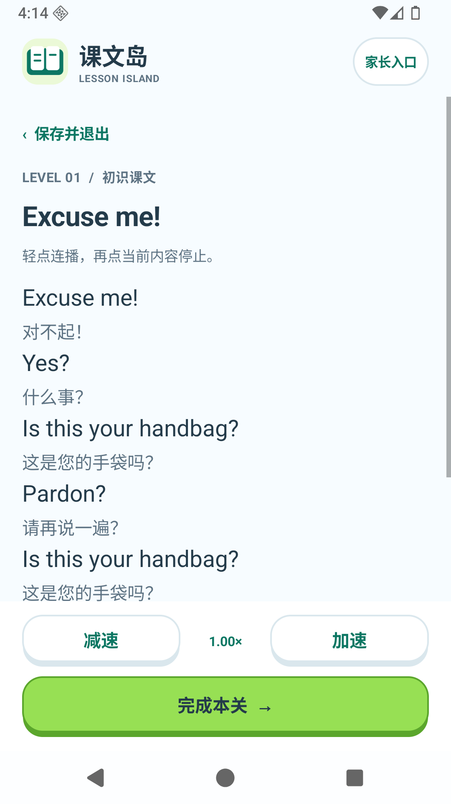
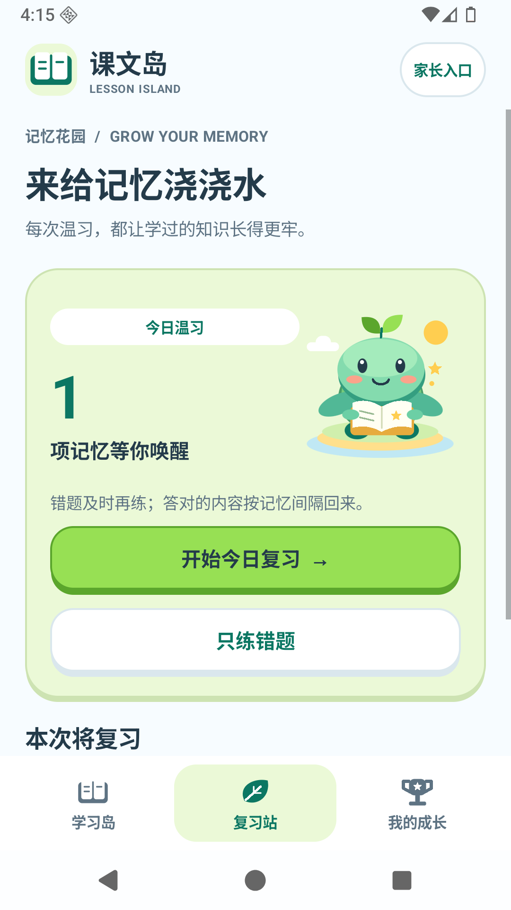
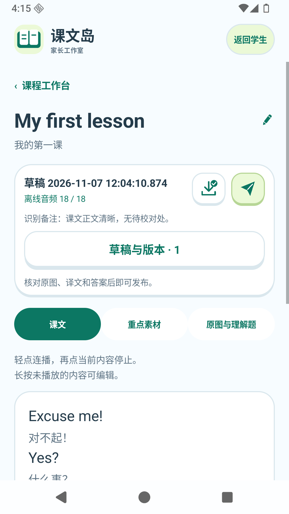
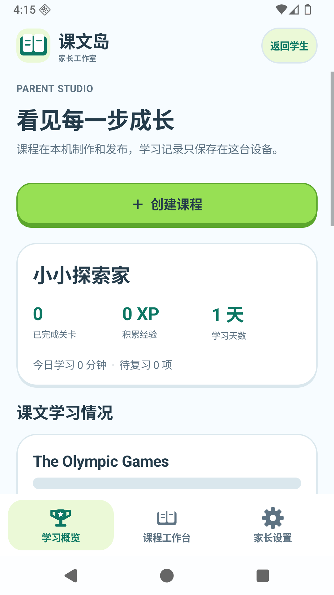

# 课文岛 · Lesson Island

面向家长和孩子的 Android 英语课文学习应用。家长将课文图片制作成课程，孩子通过听读、闯关和复习学习。支持 Android 8.0 及以上，无账号、无广告。

[下载最新版](https://github.com/whoarei/lesson-island/releases/latest) · [更新记录](CHANGELOG.md) · [使用说明](deliverables/使用说明.txt) · [开发与维护](docs/development.md)

## 界面截图

| 学习岛：选择课文 | 闯关路线：逐关解锁 | 课文听读：英中对照、变速播放 |
| :---: | :---: | :---: |
|  |  |  |

| 复习站：到期复习与错题再练 | 课程制作：校对、音频与发布 | 家长概览：查看学习情况 |
| :---: | :---: | :---: |
|  |  |  |

截图中的课程仅用于演示，正式版首次安装需由家长创建课程。

## 功能列表

- **图片制课**：一次导入最多 8 张课文图片，生成课文、逐句翻译、重点词汇与短语、理解题和英文音频。
- **校对与发布**：编辑课程内容，重新生成或录制音频；管理多份草稿与历史版本，校对后发布给孩子。
- **全文听读**：英中逐句对照，轻点连播、当前句高亮，支持 0.5–2 倍速播放。
- **六关学习**：初识课文、词汇探险、短语搭桥、听力寻宝、句子工坊、理解挑战。
- **错题与复习**：本轮错题纠正、错题专项练习，以及按 1、3、7、14、30 天安排的间隔复习。
- **断点与重练**：各篇课文、今日复习和错题复习独立续学；已完成关卡可自由重练。
- **学习成长**：记录实际前台学习时长、关卡进度、正确率、XP 和成长徽章。
- **家长管理**：PIN 保护，配置和测试模型与语音服务，查看学习概览。
- **备份与更新**：ZIP 导出恢复课程、原图、音频和学习记录；支持应用内检查与下载安装更新。

制课和语音生成需自行配置模型 API 并联网，生成内容需家长校对。课程及音频下载后可离线学习，课程和学习记录保存在本机。
